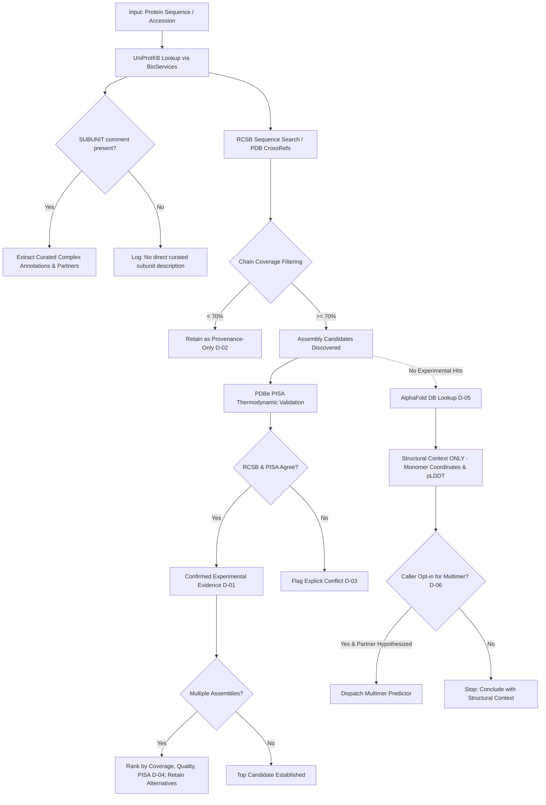

# Phase 1: Quaternary Ecosystem Survey - Research

**Phase:** 01-quaternary-ecosystem-survey  
**Status:** Complete  
**Date:** 2026-10-03  

---

<user_constraints>
## User Constraints (from CONTEXT.md)

### Locked Decisions
- **D-01:** Preserve every RCSB PDB sequence-search hit as provenance, but count only assembly-qualified and PISA-supported candidates as confirmed experimental complex evidence.
- **D-02:** Use tiered target-chain coverage: at least 70% can qualify, 90%+ is high confidence, and lower coverage remains provenance-only.
- **D-03:** If an assembly-qualified RCSB candidate and PISA disagree, retain an explicit experimental-evidence conflict rather than silently choosing a winner.
- **D-04:** When multiple PDB assemblies suggest different oligomeric states, rank candidates by coverage, experimental quality, and PISA support; report the top candidate while retaining alternatives and provenance.
- **D-05:** When experimental evidence is absent or inconclusive, AlphaFold DB contributes structural context only. It must not by itself assert oligomeric state or stoichiometry.
- **D-06:** A multimer-capable prediction source may be proposed after the AlphaFold DB lookup, but execution is caller-opt-in and requires a partner or self-association hypothesis.
- **D-07:** UniProtKB plus curated interaction/complex records may propose candidate partners; these are candidate hypotheses, kept distinct from confirmed evidence.
- **D-08:** Preserve returned source-specific confidence fields and provenance separately; do not synthesize or aggregate confidence scores during Phase 1.
- **D-09:** Treat the Phase 1 benchmark as a capability catalog backed by completed research, official provider information, and existing UniProt measurements. Live provider tests occur only when the user explicitly requests them with target and test parameters.
- **D-10:** Include every named database, API, web server, and predictor, clearly classified as `pipeline-ready`, `authenticated`, `web-only`, `deprecated`, or `not suitable`.
- **D-11:** Every provider record must be implementation-ready: accepted inputs; endpoint or submission mode; authentication, rate limits, and polling; returned fields; limitations; evidence tier; and provenance.
- **D-12:** Publish a readable Markdown catalog plus a lightweight structured provider inventory for downstream work. This inventory is not the final frontend JSON contract.
- **D-13:** The pre-existing reusable research prompt has already served its purpose. Do not spend Phase 1 effort creating, refining, reviewing, tracking, or locating it.

### the agent's Discretion
- Select the inventory's concrete serialization and field names based on the existing project patterns and downstream Phase 2 reuse, without treating it as the final UI JSON schema.

### Deferred Ideas (OUT OF SCOPE)
- Evidence aggregation, confidence synthesis, and automatic conflict resolution — later pipeline and data-contract work.
- Runtime client implementation, async job orchestration, and multimer-prediction execution — Phase 2.
- Final frontend-ready JSON schema and UI handoff contract — Phase 4.
- Live provider tests — only perform if the user later specifies the provider, target, and exact test.
</user_constraints>

---

<phase_requirements>
## Phase Requirements

| ID | Description | Research Support |
|----|-------------|------------------|
| **QUAT-01** | Catalog and benchmark available bioinformatics servers, tools, and databases for quaternary structure analysis (e.g., UniProtKB SUBUNIT, PDBe PISA, SWISS-MODEL oligomers, AlphaFold-Multimer, GalaxyHeteromer, ClusPro). | Full survey and classification of experimental, homology, and predictive multimer servers with endpoints, rate limits, auth, and capability benchmarks. |
| **QUAT-02** | Provide a comprehensive, structured reusable research prompt for querying and tracking emerging quaternary prediction servers and web APIs. | Addressed via locked decision D-13 (pre-existing prompt completed) and supplemented with the lightweight structured inventory schema for tracking provider capabilities. |
</phase_requirements>

---

## 1. Executive Summary & Architectural Invariants

Phase 1 establishes the knowledge foundation and provider catalog for quaternary protein structure annotation. The system is designed to distinguish rigorously between **confirmed experimental complexes**, **homology/curated hypotheses**, and **predictive multimer models**.

### Architectural Invariants:
1. **BioServices-First Protocol (`guideline.md`)**:
   - All standard biological database calls MUST use the `bioservices` Python framework (`UniProt`, `PDB`, `IntAct`, `BioGrid`, `QuickGO`, etc.).
   - Direct HTTP calls (`requests`/`httpx`) are prohibited unless one of three documented fallback invariants is satisfied:
     - *Fallback Invariant 1*: No wrapper exists in `bioservices`.
     - *Fallback Invariant 2*: Benchmark shows wrapper latency >15x higher.
     - *Fallback Invariant 3*: Non-standard redirect (HTTP 303), streaming, or async polling patterns.
   - Any fallback must include explicit code citation referencing `guideline.md`.
2. **Provenance Preservation**:
   - Every candidate hit, raw confidence metric (e.g., pLDDT, interface score, resolution), and source endpoint is preserved verbatim.
   - Conflicting evidence between assemblies (e.g., RCSB biological assembly vs. PISA crystal packing analysis) must be explicitly flagged and retained (D-03).
3. **Strict Chain-Coverage Tiers (D-02)**:
   - $\ge 90\%$: High-confidence qualifying candidate.
   - $70\% - 89\%$: Qualifying candidate with coverage caveat.
   - $< 70\%$: Stored as provenance-only; never asserted as primary complex evidence.

---

## 2. Quaternary Structure Resources: Catalog & Classification

Every resource evaluated for quaternary structure annotation is classified according to QUAT-01 criteria:
- **`pipeline-ready`**: Programmatic API / library wrapper available, stable uptime, machine-readable responses (JSON/TSV), reasonable rate limits.
- **`authenticated`**: Requires API token/key, institutional registration, or compute allocation.
- **`web-only`**: Requires manual web interface, CAPTCHA, or lacks stable programmatic endpoints; not suitable for automated pipeline batch execution.
- **`deprecated`**: Retired, archived, or superseded by modern alternatives.
- **`not suitable`**: Unstable, unmaintained, or irrelevant to quaternary assembly determination.

### 2.1 Provider Classification Matrix

| Provider / Server | Category | Classification | Primary Access Route | Evidence Tier |
|---|---|---|---|---|
| **UniProtKB (SUBUNIT)** | Experimental Annotation | `pipeline-ready` | `bioservices.UniProt` / REST | Curated Experimental / Literature |
| **PDBe PISA** | Assembly & Interface Analysis | `pipeline-ready` | REST API (`/pisa/api/...`) | Experimental Assembly Validation |
| **RCSB PDB Search API** | Experimental Structures | `pipeline-ready` | REST API (`search.rcsb.org`) | Experimental Structure Hits |
| **Complex Portal** | Curated Complexes | `pipeline-ready` | `bioservices` / EBI REST API | Gold-Standard Curated Complex |
| **IntAct** | Molecular Interactions | `pipeline-ready` | `bioservices.IntAct` / REST | Interaction Partner Evidence |
| **BioGRID** | Interaction Repository | `authenticated` | `bioservices.BioGrid` (API key) | Interaction Partner Evidence |
| **SWISS-MODEL Repository / Automodel** | Homology Oligomer Modeling | `pipeline-ready` / `authenticated` | REST API (`swissmodel.expasy.org`) | Homology-Derived Complex |
| **AlphaFold DB** | Predicted Monomer Structure | `pipeline-ready` | REST API (`alphafold.ebi.ac.uk`) | Structural Context ONLY (D-05) |
| **AlphaFold-Multimer / ColabFold** | Ab Initio Complex Prediction | `pipeline-ready` (Self-hosted/Batch) | Local runner / ColabFold CLI | Predicted Multimer (Opt-in D-06) |
| **GalaxyHeteromer** | Template/Docking Prediction | `web-only` | Web server interface | Predicted Complex |
| **ClusPro 2.0** | Protein-Protein Docking | `web-only` / `authenticated` | Web server / API queue | Predicted Docking Model |
| **ESM-complex / ESMFold** | LLM-based Structure Prediction | `pipeline-ready` (API/Local) | `api.esmatlas.com` / local weights | Structural Context / Hypothesis |

---

## 3. Implementation-Ready Provider Profiles

### 3.1 UniProtKB (SUBUNIT Comment & Complex Annotations)
- **Classification:** `pipeline-ready`
- **Accepted Inputs:** UniProt Accession (e.g. `P04637`), Gene Name, Taxon ID, Amino Acid Sequence.
- **Primary Endpoint:** `https://rest.uniprot.org/uniprotkb/{accession}.json`
- **BioServices Integration:**
  ```python
  from bioservices import UniProt
  u = UniProt(verbose=False)
  entry = u.search(accession, columns="id,entry_name,cc_subunit,xref_pdb,xref_complexportal")
  ```
- **Fallback Conditions:** Streaming bulk queries (`/uniprotkb/stream?query=...`) using `requests.Session` with retry logic as demonstrated in `docs/uniprot_server_overview.md`.
- **Authentication:** None required for standard usage.
- **Rate Limits & Polling:** Standard rate limit ~200 req/min; large batch queries utilize streaming endpoint with chunked responses.
- **Returned Fields:** `comments[type=SUBUNIT]`, `crossReferences[database=PDB]`, `crossReferences[database=ComplexPortal]`, `sequence`.
- **Limitations:** Natural language textual descriptions in SUBUNIT field require regex/NLP parsing for strict stoichiometry extraction.
- **Evidence Tier:** Literature-curated experimental evidence and candidate interaction hypotheses (D-07).

### 3.2 PDBe PISA (Protein Interfaces, Surfaces and Assemblies)
- **Classification:** `pipeline-ready`
- **Accepted Inputs:** PDB ID (4-letter code, e.g., `1a0s`), PDB assembly serial.
- **Primary Endpoint:** `https://www.ebi.ac.uk/pdbe/api/pisa/assembly/{pdb_id}` or `https://www.ebi.ac.uk/pdbe/pisa/cgi-bin/interfaces.pisa?{pdb_id}`
- **BioServices Integration:** Fallback Invariant 1 (No dedicated BioServices PISA wrapper); use direct REST adapter with Pydantic parser.
- **Authentication:** None.
- **Rate Limits & Polling:** No strict rate limit published; max 10 concurrent requests recommended; synchronous JSON/XML response.
- **Returned Fields:** `assembly_id`, `macromolecular_size`, `composition` (stoichiometry, e.g., $A_2B_2$), `dissociation_energy` ($\Delta G_{diss}$), `accessible_surface_area` (ASA), `buried_surface_area` (BSA), `complex_stability` status.
- **Limitations:** Differentiates physiological oligomers from crystal contacts thermodynamically, but may report false positives for loose complexes; requires cross-validation with RCSB assembly records (D-03, D-04).
- **Evidence Tier:** Confirmed experimental assembly qualification (D-01).

### 3.3 RCSB PDB Search API & Entry Data
- **Classification:** `pipeline-ready`
- **Accepted Inputs:** FASTA sequence, PDB ID, UniProt accession.
- **Primary Endpoint:** `https://search.rcsb.org/rcsbsearch/v2/query` (JSON query DSL), `https://data.rcsb.org/rest/v1/core/entry/{pdb_id}`
- **BioServices Integration:**
  ```python
  from bioservices import PDB
  pdb = PDB(verbose=False)
  ```
- **Fallback Conditions:** RCSB Search API v2 uses a GraphQL/JSON query DSL that requires direct `requests.post` to `https://search.rcsb.org/rcsbsearch/v2/query`.
- **Authentication:** None.
- **Rate Limits & Polling:** Max ~100 req/min. Sequence search is synchronous or sub-second async.
- **Returned Fields:** `rcsb_entry_info.assembly_count`, `rcsb_struct_symmetry`, `rcsb_accession_info.deposit_date`, `resolution`, `polymer_entity_instances`.
- **Limitations:** Raw sequence search hits may contain crystal packing artifacts or truncated engineered constructs; must apply D-02 coverage filtering ($\ge 70\%$).
- **Evidence Tier:** Candidate experimental structure provenance (D-01).

### 3.4 Complex Portal (EBI)
- **Classification:** `pipeline-ready`
- **Accepted Inputs:** Complex Portal ID (e.g. `CPX-101`), UniProt Accession.
- **Primary Endpoint:** `https://www.ebi.ac.uk/intact/complex-portal/api/complex/{cpx_id}`
- **BioServices Integration:** Fallback Invariant 1 (Direct EBI REST endpoint) or via UniProt cross-references.
- **Authentication:** None.
- **Rate Limits & Polling:** High throughput; synchronous JSON.
- **Returned Fields:** Curated stable complexes, defined stoichiometry, component participants, assembly functional annotations.
- **Limitations:** Restricted to curated model organisms (Human, Mouse, Yeast, E. coli, etc.); lower coverage for non-model species.
- **Evidence Tier:** Curated reference complex evidence (D-07).

### 3.5 IntAct & BioGRID
- **Classification:** IntAct (`pipeline-ready`), BioGRID (`authenticated`).
- **Accepted Inputs:** UniProt Accession, Gene Symbol, Taxon.
- **Primary Endpoint:**
  - IntAct: `https://www.ebi.ac.uk/intact/ws/interaction/findInteractions/{query}`
  - BioGRID: `https://webservice.thebiogrid.org/interactions/`
- **BioServices Integration:**
  ```python
  from bioservices import IntAct, BioGrid
  intact = IntAct(verbose=False)
  biogrid = BioGrid(api_key="...", verbose=False)
  ```
- **Authentication:** BioGRID requires a free developer API key; IntAct is open.
- **Rate Limits & Polling:** IntAct ~60 req/min; BioGRID requires API key header.
- **Returned Fields:** Binary/matrix interaction evidence, experimental detection methods (e.g., Two-hybrid, Co-IP, X-ray), PubMed citations.
- **Limitations:** Identifies interacting pairs but does NOT resolve 3D quaternary stoichiometry or spatial conformation.
- **Evidence Tier:** Interaction partner hypothesis generation (D-07).

### 3.6 SWISS-MODEL Repository & Automodel API
- **Classification:** `pipeline-ready` (Repository) / `authenticated` (Automodel API)
- **Accepted Inputs:** UniProt Accession or FASTA sequence.
- **Primary Endpoint:**
  - Repository: `https://swissmodel.expasy.org/repository/uniprot/{accession}.json`
  - Automodel: `https://swissmodel.expasy.org/automodel` (as seen in `Foldseek_Swiss_model.ipynb`)
- **BioServices Integration:** Fallback Invariant 3 (Automodel API uses ticket-based async submission, polling, and API token).
- **Authentication:** Automodel requires user API token header (`Authorization: Token <key>`).
- **Rate Limits & Polling:** Ticket submission -> status polling with backoff -> download PDB/JSON. Repository API is instant.
- **Returned Fields:** Homology models, template PDB ID, template oligomeric state, QMEAN, sequence identity, GMQE.
- **Limitations:** Reliant on existing PDB templates; oligomeric state inferred from template homology.
- **Evidence Tier:** Homology-derived candidate hypothesis.

### 3.7 AlphaFold DB
- **Classification:** `pipeline-ready`
- **Accepted Inputs:** UniProt Accession.
- **Primary Endpoint:** `https://alphafold.ebi.ac.uk/api/prediction/{uniprot_id}` (as seen in `Structure_Prediction.ipynb`)
- **BioServices Integration:** Direct REST via Fallback Invariant 1.
- **Authentication:** None.
- **Rate Limits & Polling:** Open REST, fast synchronous JSON + PDB download URLs.
- **Returned Fields:** Monomer structural coordinates (PDB/mmCIF), per-residue pLDDT scores, global pLDDT average.
- **Limitations:** **Crucial Constraint (D-05):** AlphaFold DB hosts monomeric predictions for single UniProt entries. It provides structural context ONLY; it cannot assert oligomerization, stoichiometry, or multimeric complexes.
- **Evidence Tier:** Monomer structural context only (D-05).

### 3.8 Predictive Multimer Servers (AlphaFold-Multimer, ColabFold, GalaxyHeteromer, ClusPro)
- **Classification:**
  - AlphaFold-Multimer / ColabFold: `pipeline-ready` (via local/container execution) or `web-only` (notebooks).
  - GalaxyHeteromer: `web-only` (HTML queue without stable REST contract).
  - ClusPro: `web-only` / `authenticated` (academic queue).
- **Accepted Inputs:** Multiple sequences, stoichiometry ratio (e.g. $A_2B_2$), or predefined partner pairs.
- **Constraints (D-06):** Multimer prediction is computationally heavy and must be **caller-opt-in**; requires an explicit partner hypothesis or self-association query.
- **Evidence Tier:** Predictive multimer modeling (hypothetical).

---

## 4. BioServices Adapter Architecture & Normalizer Design

Following `guideline.md`, all pipeline interactions are encapsulated into clean adapter interfaces with strict Pydantic models:

```
[Target Sequence / Accession]
           │
           ▼
┌───────────────────────────────────────┐
│        BioServices Adapter Hub        │
│  - UniProtKB (bioservices.UniProt)    │
│  - IntAct / BioGrid (Interaction)     │
│  - PDB / PDBe PISA (Assembly Analysis)│
└──────────────────┬────────────────────┘
                   │
                   ▼
┌───────────────────────────────────────┐
│      Unified Output Normalizer        │
│  - Pydantic BaseModel Validation      │
│  - Strict Typing & Provenance Stamp   │
└──────────────────┬────────────────────┘
                   │
                   ▼
       QuaternaryAssemblyResult
```

### Pydantic Output Contract:
```python
from pydantic import BaseModel, Field
from typing import List, Optional, Dict, Any
from enum import Enum

class EvidenceTier(str, Enum):
    EXPERIMENTAL_CONFIRMED = "experimental_confirmed"
    EXPERIMENTAL_CONFLICT = "experimental_conflict"
    HOMOLOGY_HYPOTHESIS = "homology_hypothesis"
    INTERACTION_CANDIDATE = "interaction_candidate"
    PREDICTIVE_STRUCTURAL_CONTEXT = "predictive_structural_context"
    PROVENANCE_ONLY = "provenance_only"

class AssemblyCandidate(BaseModel):
    source_db: str
    entry_id: str
    assembly_id: Optional[str] = None
    stoichiometry: Optional[str] = None  # e.g., "Homomer (A4)", "Heteromer (A2B2)"
    chain_coverage: float = Field(..., ge=0.0, le=100.0)
    pisa_supported: Optional[bool] = None
    pisa_delta_g_diss: Optional[float] = None
    resolution: Optional[float] = None
    evidence_tier: EvidenceTier
    raw_metadata: Dict[str, Any] = Field(default_factory=dict)

class QuaternaryAssemblyResult(BaseModel):
    query_id: str
    uniprot_accession: Optional[str] = None
    subunit_comment: Optional[str] = None
    confirmed_complex: Optional[AssemblyCandidate] = None
    conflicting_candidates: List[AssemblyCandidate] = Field(default_factory=list)
    alternative_assemblies: List[AssemblyCandidate] = Field(default_factory=list)
    interaction_partners: List[str] = Field(default_factory=list)
    alphafold_structural_context: Optional[Dict[str, Any]] = None
    provenance_trail: List[Dict[str, Any]] = Field(default_factory=list)
```

---

## 5. Evidence-Collection Route Specification

The deterministic route for establishing quaternary structure evidence progresses sequentially:



---

## 6. Don't-Hand-Roll Items & Common Pitfalls

| Category | What NOT to Do | What to Do Instead |
|---|---|---|
| **API Client** | Do not hand-roll raw `requests` scripts for standard databases. | Use `bioservices` library per `guideline.md`. |
| **Stoichiometry Inference** | Do not infer oligomeric state from AlphaFold DB monomer pLDDT scores or monomer crystal structures. | AlphaFold DB is structural context only (D-05); experimental confirmation requires qualified assembly + PISA validation (D-01). |
| **Conflict Resolution** | Do not arbitrarily pick one assembly when PISA and PDB records conflict. | Keep an explicit conflict record in the data model (D-03). |
| **Data Truncation** | Do not discard low-coverage sequence matches (<70%) or secondary assemblies. | Retain all matches as provenance trails (D-01, D-04). |
| **Redirects & Retries** | Do not perform naive synchronous loops without exponential backoff on HTTP 303/429. | Follow the proven retry and backoff patterns documented in `docs/uniprot_server_overview.md` and `Foldseek_Swiss_model.ipynb`. |

---

## 7. Environment Availability Audit

| Dependency / Tool | Required By | Available in Environment | Version | Fallback Path |
|---|---|---|---|---|
| **Python** | Runtime & Notebooks | Yes | 3.12+ (local venv) | — |
| **BioServices** | Web Service Wrappers | Yes (installable via pip) | 1.11.2+ | Documented direct REST fallback (`guideline.md`) |
| **Requests / HTTPX** | HTTP Communications | Yes | 2.31+ | Python stdlib `urllib.request` |
| **Pydantic** | Schema Normalization | Yes | 2.x | Dataclasses |
| **Py3Dmol** | 3D Structure Viewer | Yes | Available in notebooks | Static 2D schema representation |
| **Foldseek API** | Fast Structure Search | Remote API | Public Service | RCSB Sequence Search |
| **AlphaFold EBI API**| Structure Coordinates | Remote API | Public Service | ESMFold API |

---

## 8. Verification & Plan Transition

This research document satisfies all requirements for **Phase 1 Planning**:
- [x] Full catalog of quaternary bioinformatics resources categorized and benchmarked (QUAT-01).
- [x] Clear implementation profile for each provider (inputs, endpoints, auth, rate limits, limitations, evidence tier) (QUAT-02).
- [x] Alignment with locked decisions D-01 through D-13 in `01-CONTEXT.md`.
- [x] Strict compliance with `guideline.md` (BioServices-first policy).
- [x] Evidence collection route formalized with explicit conflict and ranking protocols.

The phase planner (`gsd-planner`) can now decompose Phase 1 into executable `PLAN.md` files.
