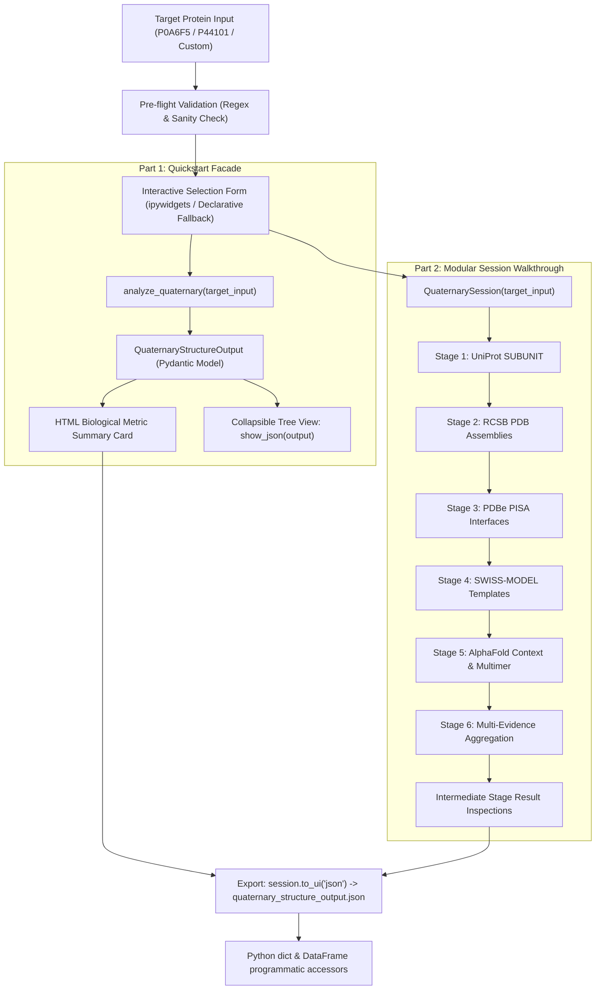

# Phase 3: Abstracted Interactive Jupyter Notebook - Research

**Researched:** 2026-10-04
**Domain:** Interactive Jupyter Notebook Design, Bioinformatics Workflow Abstraction, IPython Visual Displays
**Confidence:** HIGH

<user_constraints>
## User Constraints (from CONTEXT.md)

### Locked Decisions
- **D-01 (Dual-mode input):** Provide interactive `ipywidgets` (accession text box, example dropdown, multimer checkbox, run button) with seamless fallback to declarative Python variables (`TARGET_PROTEIN = "P0A6F5"`) in headless or non-interactive environments.
- **D-02 (Pre-flight validation):** Validate accession regex and FASTA sequence integrity before dispatching pipeline calls, rendering clean HTML/markdown alerts for malformed inputs rather than uncaught stack traces.
- **D-03 (Lightweight stage logging):** Keep execution feedback clean and readable using console stage prints (`[STAGE 1/6: UNIPROT SUBUNIT] ...`), avoiding heavy UI widget redraw overhead (UI team builds frontend web application).
- **D-04 (Collapsible JSON Tree + Biological Summary):** Adopt `show_json(data, max_depth=1)` from `UniProtKB.ipynb` using `renderjson@1.4.0` via `IPython.display.HTML`. Supplement with a clean HTML summary table displaying top-level quaternary metrics (Assembly Type, Stoichiometry Formula, Subunit Count, Interface Confidence).
- **D-05 (No 3D molecular rendering in notebook):** Exclude 3D coordinates viewer from `Quaternary_Structure.ipynb` (already covered in `Structure_Prediction.ipynb`). Logged as GitHub Issue #4 for the UI team.
- **D-06 (Two-tier workflow structure):**
  - *Part 1: Quickstart Facade* — 1-line `analyze_quaternary(target_input)` call providing instant end-to-end characterization.
  - *Part 2: Modular Session Walkthrough* — Step-wise walkthrough using `QuaternarySession` running stages 1 through 6 individually (`run_stage_1_uniprot_subunit` through `run_stage_6_aggregate`) with intermediate inspection.
- **D-07 (Dual export formats):** Export `quaternary_structure_output.json` via `session.to_ui(format="json")`, while also providing direct Python dictionary and Pandas DataFrame accessors (`session.to_ui(format="dict")` / `format="dataframe"`).
- **D-08 (Dual showcase targets):** Pre-configure GroEL chaperone (`P0A6F5`) as positive control with rich experimental ground truth, and *Haemophilus influenzae* protein (`P44101` / Proteome `UP000000579`) demonstrating predictive fallback.
- **D-09 (High-yield scientific commentary):** Provide educational markdown cells explaining quaternary assembly, stoichiometry formulas ($A_2B$, $A_{14}$), buried surface area ($\Delta G$, hydrogen bonds), and confidence score provenance.

### The Agent's Discretion
- Visual theme color accents for summary table matching UniProtKB renderjson palette.
- Specific cell ordering within Part 1 and Part 2.

### Deferred Ideas (OUT OF SCOPE)
- Frontend 3D multimer/complex viewer integration (tracked in GitHub Issue #4).
</user_constraints>

<architectural_responsibility_map>
## Architectural Responsibility Map

| Capability | Primary Tier | Secondary Tier | Rationale |
|------------|-------------|----------------|-----------|
| High-level Quaternary Execution | API/Backend (`quaternary_pipeline.py`) | Jupyter Kernel | Notebook only invokes facade; all HTTP, retries, and aggregation stay in engine |
| Interactive Parameter Selection | Jupyter Notebook Client (`ipywidgets`) | Python Variables | Interactive form for users; programmatic variables for automated testing |
| Stage-wise Inspection | Jupyter Notebook Client (`IPython.display`) | Engine Session | Inspects intermediate `StageResult` dataclasses from `QuaternarySession` |
| JSON Contract Export | Jupyter Notebook Client | Filesystem / Frontend | Writes `quaternary_structure_output.json` for frontend consumption |
| 3D Structure Viewer | Web Frontend (UI Team) | — | Handled by dedicated frontend team (Issue #4) |
</architectural_responsibility_map>

<research_summary>
## Summary

Phase 3 implements `Quaternary_Structure.ipynb` as the primary user-facing notebook demonstration for the bioinformatics server. The engine abstraction layer completed in Phase 2 (`quaternary_pipeline.py` and `quaternary/`) cleanly isolates all HTTP requests, retry logic, and Pydantic v2 domain models. The notebook's responsibility is purely declarative: orchestrating the pipeline, presenting scientific insights, and outputting the standardized JSON contract without exposing internal plumbing.

Based on codebase analysis of existing notebooks in the repository (`UniProtKB.ipynb`, `Foldseek_Swiss_model.ipynb`, `Structure_Prediction.ipynb`), the established visual pattern is clean, dark-themed HTML/JS injection via `IPython.display.HTML`. Specifically, `UniProtKB.ipynb` defines a collapsible tree viewer (`show_json`) leveraging `renderjson@1.4.0`. Reusing this exact utility guarantees visual consistency and avoids installing extraneous heavy widget libraries.

The notebook is partitioned into two distinct tiers: Part 1 provides a fast, one-line quickstart (`analyze_quaternary`), and Part 2 walks through the six modular stages (`QuaternarySession`). Both parts support dual showcase targets (positive control GroEL `P0A6F5` and *Haemophilus influenzae* `P44101`).

**Primary recommendation:** Build `Quaternary_Structure.ipynb` using `nbformat` with pure high-level imports (`from quaternary_pipeline import ...`), embed the battle-tested `show_json` viewer from `UniProtKB.ipynb`, incorporate pre-flight regex validation, and verify end-to-end execution headlessly using a custom execution script.
</research_summary>

<standard_stack>
## Standard Stack

### Core
| Library | Version | Purpose | Why Standard |
|---------|---------|---------|--------------|
| `quaternary_pipeline` | Phase 2 | Façade API & domain models | Unified entry point exposing `analyze_quaternary` & `QuaternarySession` |
| `IPython` | 8.23.0 | Display abstractions (`HTML`, `display`) | Standard interactive display engine in Jupyter |
| `ipywidgets` | 8.1.5 | Interactive form controls (dropdown, text, button) | Native Jupyter interactive widgets with fallback |
| `pandas` | 3.0.3 | Summary tabular metrics formatting | Universal tabular representation in Python data science |
| `renderjson` | 1.4.0 (CDN) | Collapsible dark-mode JSON tree viewer | Established in `UniProtKB.ipynb`, zero-install client-side tree view |
| `nbformat` | 5.10.4 | Notebook generation and schema validation | Official Jupyter notebook document format library |

### Supporting
| Library | Version | Purpose | When to Use |
|---------|---------|---------|-------------|
| `re` | stdlib | Accession format regex pre-flight check | Input validation cell |
| `json` | stdlib | Serializing export contracts | File output cell |
| `pathlib` | stdlib | Path handling for exports | Export verification |

### Alternatives Considered
| Instead of | Could Use | Tradeoff |
|------------|-----------|----------|
| `renderjson` via HTML | `ipywidgets.Tree` or custom GUI | `renderjson` is already established in repo (`UniProtKB.ipynb`), requires no custom kernel extensions, and renders cleanly in dark mode |
| Lightweight console logging | Complex ipywidgets progress bar | User explicitly noted UI is handled by frontend team; console stage prints eliminate redraw glitches and kernel desync |
| Embedded 3D viewer | `py3Dmol` | Excluded per user direction (already covered in `Structure_Prediction.ipynb`; tracked for UI team in Issue #4) |
</standard_stack>

<architecture_patterns>
## Architecture Patterns

### Two-Tier Notebook Workflow Architecture


### Pattern 1: show_json Dark Tree Viewer
```python
import json
import uuid
from IPython.display import HTML, display

def show_json(data, max_depth=1):
    """Renders JSON in a VS Code style dark tree view with collapsible arrows."""
    if hasattr(data, "model_dump"):
        data = data.model_dump()
    elif isinstance(data, str):
        data = json.loads(data)
        
    container_id = f"json_viewer_{uuid.uuid4().hex}"
    json_str = json.dumps(data, default=str)
    
    html_code = f"""
    <div id="{container_id}" style="background-color: #1e1e1e; padding: 14px; border-radius: 6px; font-family: 'Cascadia Code', 'Fira Code', Consolas, monospace; font-size: 13px; text-align: left; overflow-x: auto;"></div>
    <script src="https://cdn.jsdelivr.net/npm/renderjson@1.4.0/renderjson.min.js"></script>
    <script>
        (function() {{
            renderjson.set_show_to_level({max_depth});
            renderjson.set_icons('&#9654; ', '&#9660; ');
            var container = document.getElementById("{container_id}");
            if (container) {{ container.appendChild(renderjson({json_str})); }}
        }})();
    </script>
    <style>
        #{container_id} .renderjson {{ color: #d4d4d4; line-height: 1.5; }}
        #{container_id} .renderjson .disclosure {{ color: #808080; cursor: pointer; text-decoration: none; font-weight: bold; margin-right: 2px; }}
        #{container_id} .renderjson .disclosure:hover {{ color: #ffffff; }}
        #{container_id} .renderjson .syntax {{ color: #ffd700; }}
        #{container_id} .renderjson .string {{ color: #ce9178; }}
        #{container_id} .renderjson .number {{ color: #b5cea8; }}
        #{container_id} .renderjson .boolean {{ color: #569cd6; }}
        #{container_id} .renderjson .key {{ color: #9cdcfe; }}
        #{container_id} .renderjson .keyword {{ color: #c586c0; }}
    </style>
    """
    display(HTML(html_code))
```

### Pattern 2: Dual Mode Input with Seamless Fallback
```python
# Cell 3: Parameters & Interactive Input Form
TARGET_PROTEIN = "P0A6F5"  # Default: GroEL chaperone (Positive Control)
ENABLE_MULTIMER = False

try:
    import ipywidgets as widgets
    from IPython.display import display
    
    preset_dropdown = widgets.Dropdown(
        options=[
            ("GroEL Chaperonin (Positive Control - 14-mer)", "P0A6F5"),
            ("Insulin (Positive Control - Hexamer)", "P01308"),
            ("Haemophilus influenzae uncharacterized (QUAT-09)", "P44101"),
            ("Custom Accession / FASTA", "CUSTOM")
        ],
        value="P0A6F5",
        description="Preset:"
    )
    accession_input = widgets.Text(value="P0A6F5", description="Accession:")
    multimer_checkbox = widgets.Checkbox(value=False, description="Enable Multimer Predictor")
    
    def on_preset_change(change):
        if change["new"] != "CUSTOM":
            accession_input.value = change["new"]
            
    preset_dropdown.observe(on_preset_change, names="value")
    display(widgets.VBox([preset_dropdown, accession_input, multimer_checkbox]))
except Exception as e:
    print(f"Interactive widgets unavailable ({e}). Using declarative variables: TARGET_PROTEIN={TARGET_PROTEIN}")
```

### Anti-Patterns to Avoid
- **Raw HTTP calls in notebook cells:** Violates QUAT-06. All network queries MUST go through `quaternary_pipeline.py`.
- **Hardcoding JSON parsing or dict indexing:** All returned objects are Pydantic models with typed attributes.
- **Uncontrolled kernel hangs on remote APIs:** `quaternary_pipeline` already implements non-fatal fallbacks with timeouts; the notebook must rely on this architecture.
- **Silent failure on bad input:** Failing to validate accession or FASTA leads to mysterious 404s; the pre-flight cell must surface user-friendly syntax guidance immediately.
</architecture_patterns>

<dont_hand_roll>
## Don't Hand-Roll

| Problem | Don't Build | Use Instead | Why |
|---------|-------------|-------------|-----|
| Quaternary pipeline logic | Custom REST calls & parsers in cells | `from quaternary_pipeline import analyze_quaternary, QuaternarySession` | Centralizes retries, caching, error recovery, and data models |
| JSON tree visualization | Hand-crafted HTML/CSS tree widget | `show_json(...)` via `renderjson@1.4.0` | Established standard in `UniProtKB.ipynb`, tested collapsible tree |
| Export data serialization | Custom dict conversions | `session.to_ui(format="json")` / `.model_dump_json()` | Complies with strict Pydantic v2 schemas and frontend contract |
| Protein input regex | Ad-hoc string slicing | Standard UniProt accession regex `^[O,P,Q][0-9][A-Z, 0-9]{3}[0-9]|[A-N,R-Z][0-9]([A-Z][A-Z, 0-9]{2}[0-9]){1,2}$` | Handles standard 6 and 10 character UniProtKB accession rules |
</dont_hand_roll>

<validation_architecture>
## Validation Architecture

To deterministically verify `Quaternary_Structure.ipynb`:
1. **Schema & Syntax Validation**: Use `nbformat` to validate notebook JSON schema compliance (version 4.4+).
2. **Import & Surface Isolation**: Verify that `Quaternary_Structure.ipynb` contains zero instances of `requests.get`, `requests.post`, `urllib`, or raw REST URLs in its code cells. All calls must route through `quaternary_pipeline`.
3. **Headless Execution Test**: Execute the notebook cells using `nbclient` or an automated Python runner to verify top-to-bottom error-free execution.
4. **Contract Verification**: Assert that `quaternary_structure_output.json` is generated on disk and validates against `QuaternaryStructureOutput.model_validate_json(...)`.
</validation_architecture>
