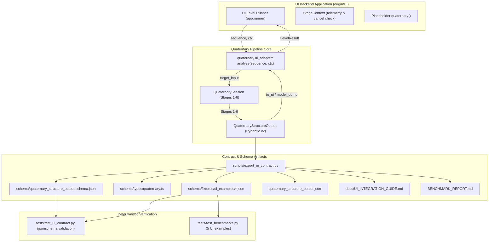

# Phase 4: Standardized UI JSON Data Contract & Benchmark Validation - Research

**Researched:** 2026-10-05  
**Domain:** Bioinformatics UI Data Contracts, JSON Schema 2020-12, Backend-to-Frontend LevelResult Adapters, and Benchmark Verification  
**Confidence:** HIGH  

<user_constraints>
## User Constraints (from CONTEXT.md)

### Locked Decisions
- **D-01 (Pydantic-Driven Schema)**: Generate standard JSON Schema (Draft 2020-12) directly via `QuaternaryStructureOutput.model_json_schema()` into `schema/quaternary_structure_output.schema.json` to guarantee 100% synchronization with the engine.
- **D-02 (Multi-Archetype Fixture Pack & Generic Extensibility)**: Export reference payloads under `schema/fixtures/` and a canonical `quaternary_structure_output.json` at root. Ensure the schema and contract remain strictly generic and flexible so the UI can run on arbitrary targets and custom inputs as well.
- **D-03 (Automated JSON Schema Test Gate)**: Implement `tests/test_ui_contract.py` using `jsonschema` to validate all exported sample fixtures and arbitrary target outputs against the published schema.
- **D-04 (Dual Export Exposure)**: Provide both a CLI generator script (`scripts/export_ui_contract.py`) for CI/batch regeneration and an interactive export cell in `Quaternary_Structure.ipynb`.
- **D-05 (Direct Alignment with UI Branch)**: Benchmark the 5 canonical example proteins established in `origin/UI:UI/backend/app/examples.py`:
  1. `ubiquitin` (PDB: `1UBQ`, Monomer)
  2. `hemoglobin-alpha` (UniProt: `P69905`, Heterotetramer $\alpha_2\beta_2$)
  3. `bacteriorhodopsin` (UniProt: `P02945`, Homotrimer)
  4. `p53` (UniProt: `P04637`, Homotetramer)
  5. `akt1` (UniProt: `P31749`, Monomer)
- **D-06 (Amended QUAT-09 Scope)**: Replace *H. influenzae* UP000000579 entirely with the 5 UI examples across both benchmark execution and sample fixtures, matching the active UI application.
- **D-07 (Comprehensive Benchmark Deliverables)**: Author `BENCHMARK_REPORT.md` documenting oligomeric state prediction accuracy, stoichiometry, PISA interface contacts, and runtime performance. Save their exported JSON outputs in `schema/fixtures/ui_examples/` and assert determinism via `tests/test_benchmarks.py`.
- **D-08 (Deferred Novel Sequence Scope)**: Fully skip novel/synthetic unannotated sequence validation for Phase 4 to focus strictly on happy-path delivery for the UI team. Defer comprehensive boundary testing and negative controls to a dedicated future milestone/GitHub issue.
- **D-09 (Direct UI LevelResult Adapter)**: Implement `quaternary/ui_adapter.py` providing `analyze(sequence: str, ctx: StageContext) -> LevelResult` matching `UI/docs/LEVEL_CONTRACT.md` and `UI/backend/app/schemas.py:LevelResult` as a drop-in replacement for the quaternary placeholder. Embed full model dump in `raw`.
- **D-10 (Visual Presentation Mappings)**: Map quaternary state to `headline` (predicted assembly), interface contact residues to `tracks` (`style="marks"`, `tone="ink"`), subunits and PISA chemistry to `tables`, and the bio-mechanistic hypothesis to `notes`.
- **D-11 (Handoff Documentation)**: Author `docs/UI_INTEGRATION_GUIDE.md` with complete data dictionary, enum descriptions, nullability rules, visual tone mappings, and drop-in integration instructions.
- **D-12 (TypeScript Definitions)**: Export clean TypeScript interfaces (`schema/types/quaternary.ts`) matching `QuaternaryStructureOutput` for frontend component building.

### the agent's Discretion
- Exact layout of `BENCHMARK_REPORT.md` tables and performance timings.
- Helper utilities in `quaternary/ui_adapter.py` for parsing `ctx.report()` progress telemetry during execution.

### Deferred Ideas (OUT OF SCOPE)
- Comprehensive novel/synthetic sequence validation and scrambled negative-control testing (QUAT-10).
- Live cloud runner integration for AlphaFold-Multimer GPU batch runs.

</user_constraints>

<architectural_responsibility_map>
## Architectural Responsibility Map

| Capability | Primary Tier | Secondary Tier | Rationale |
|------------|-------------|----------------|-----------|
| JSON Schema Draft 2020-12 Export | Backend Engine (`quaternary.models`) | CLI Scripts (`scripts/`) | Pydantic v2 domain schemas (`QuaternaryStructureOutput`) are the authoritative source of truth for all biological data models. |
| UI `LevelResult` Adapter | Backend Integration Layer (`quaternary.ui_adapter`) | Fullstack Server (`UI/backend/app/levels/`) | Translates rich domain models into the shared `LevelResult` presentation shape without requiring any changes to frontend React/TypeScript components. |
| Proteome Benchmarking Suite | Automated Verification (`tests/`, `scripts/`) | Documentation (`docs/`) | Executes the 5 canonical UI examples, records biological assembly accuracy and runtime metrics in `BENCHMARK_REPORT.md`, and persists fixtures. |
| TypeScript Interface Generation | Schema Definition (`schema/types/`) | Frontend UI (`UI/frontend/src/`) | Provides strict compile-time typing for frontend developers consuming raw quaternary output dictionaries. |

</architectural_responsibility_map>

<research_summary>
## Summary

Phase 4 bridges the robust computational core developed in Phases 2–03.2 with the external frontend application established in the `UI` repository branch (`origin/UI`). Investigation of the `UI` branch reveals an elegant architectural design: every structural level (primary, secondary, tertiary, quaternary) is consumed by the frontend via a unified presentation schema called `LevelResult` (defined in `UI/backend/app/schemas.py`). The UI backend runs each level through an `analyze(sequence: str, ctx: StageContext) -> LevelResult` interface and currently uses a placeholder function in `UI/backend/app/levels/placeholders.py:quaternary`.

Rather than merely outputting an isolated static JSON file, Phase 4 delivers a cohesive contract ecosystem:
1. **Automated JSON Schema Export**: Using Pydantic v2's native `model_json_schema()`, the pipeline generates `schema/quaternary_structure_output.schema.json` compliant with JSON Schema Draft 2020-12, verified deterministically using the Python `jsonschema` package.
2. **Direct UI Adapter**: A clean adapter module (`quaternary/ui_adapter.py`) translates `QuaternaryStructureOutput` directly into `LevelResult`, mapping oligomeric state to `Headline`, interface contact residues to an interactive `marks` residue-map `Track`, macromolecular subunits and PISA biophysics to `Table` components, and the bio-mechanistic hypothesis to a `Note`.
3. **Canonical UI Benchmarking**: The 5 default UI examples (`ubiquitin`, `hemoglobin-alpha`, `bacteriorhodopsin`, `p53`, and `akt1`) are benchmarked end-to-end, producing verified payload fixtures in `schema/fixtures/ui_examples/`, a root `quaternary_structure_output.json`, and an executive `BENCHMARK_REPORT.md`.
4. **Developer Handoff**: `docs/UI_INTEGRATION_GUIDE.md` and `schema/types/quaternary.ts` provide complete guidance, enabling the UI developer to replace the placeholder with a one-line import.

**Primary recommendation:** Build `quaternary/ui_adapter.py` conforming strictly to `UI/backend/app/schemas.py:LevelResult`, author `scripts/export_ui_contract.py` to regenerate all schemas and fixtures, and lock contract conformance with `tests/test_ui_contract.py` and `tests/test_benchmarks.py`.

</research_summary>

<standard_stack>
## Standard Stack

### Core
| Library | Version | Purpose | Why Standard |
|---------|---------|---------|--------------|
| `pydantic` | `>=2.5.0` | Data modeling & JSON Schema emission | Native Draft 2020-12 JSON Schema generation via `model_json_schema()`. Eliminates drift between code and contract. |
| `jsonschema` | `>=4.20.0` | Draft 2020-12 Schema validation in test suite | The industry standard Python validator for verifying JSON documents against formal JSON Schema files. |
| `quaternary` | Local package | Multi-stage Quaternary Analysis Engine | Executes Stages 1–6, PISA thermodynamics, candidate ranking, and functional inference. |

### Supporting
| Library | Version | Purpose | When to Use |
|---------|---------|---------|-------------|
| `pandas` | `>=2.0.0` | Tabular display formatting | Used by `session.to_ui(format="dataframe")` for tabular notebook outputs. |
| `pytest` | `>=8.0.0` | Deterministic verification test runner | Gates CI/CD and asserts contract validity across all fixtures and benchmarks. |

</standard_stack>

<architecture_patterns>
## Architecture Patterns

### System Architecture Diagram



### Recommended Project Structure
```
bioinformatics_project/
├── quaternary/
│   ├── ui_adapter.py                 # Direct drop-in adapter returning LevelResult
│   ├── models/
│   │   ├── session_state.py          # QuaternaryStructureOutput definition
│   │   └── ...
│   └── session.py                    # QuaternarySession
├── schema/
│   ├── quaternary_structure_output.schema.json  # Published Draft 2020-12 schema
│   ├── types/
│   │   └── quaternary.ts             # Curated TypeScript interface definitions
│   └── fixtures/
│       ├── quaternary_structure_output.json     # Canonical root export
│       └── ui_examples/                         # 5 canonical benchmark fixtures
│           ├── ubiquitin.json
│           ├── hemoglobin_alpha.json
│           ├── bacteriorhodopsin.json
│           ├── p53.json
│           └── akt1.json
├── scripts/
│   └── export_ui_contract.py         # Batch export CLI script
├── docs/
│   └── UI_INTEGRATION_GUIDE.md       # Comprehensive developer handoff guide
├── BENCHMARK_REPORT.md               # Empirical benchmark analysis report
└── tests/
    ├── test_ui_contract.py           # jsonschema validation suite
    └── test_benchmarks.py            # Accuracy & performance assertions
```

### Pattern 1: Pydantic v2 JSON Schema Draft 2020-12 Generation
```python
import json
from pathlib import Path
from quaternary.models import QuaternaryStructureOutput

def export_schema(output_path: Path) -> dict:
    """Generate Draft 2020-12 JSON Schema directly from Pydantic domain model."""
    schema = QuaternaryStructureOutput.model_json_schema()
    schema["$schema"] = "https://json-schema.org/draft/2020-12/schema"
    schema["title"] = "QuaternaryStructureOutput"
    schema["description"] = "Canonical data contract for protein quaternary structure synthesis and UI export."
    output_path.write_text(json.dumps(schema, indent=2), encoding="utf-8")
    return schema
```

### Pattern 2: Modular `LevelResult` Mapping
```python
def map_output_to_level_result(output: QuaternaryStructureOutput) -> dict:
    """Map QuaternaryStructureOutput into the UI's shared LevelResult presentation dictionary."""
    headline_value = output.stoichiometry.state or "UNKNOWN"
    if output.stoichiometry.formula:
        headline_value += f" ({output.stoichiometry.formula})"

    # Residue track marks (1-based inclusive)
    segments = []
    for contact in output.interfaces:
        for res_num in contact.contact_residues_chain1:
            segments.append({"start": res_num, "end": res_num, "tone": "ink", "label": "interface"})

    return {
        "source": "live",
        "headline": {"value": headline_value, "label": "quaternary assembly"},
        "summary": f"Target oligomeric assembly evaluated as {headline_value} with {len(output.interfaces)} verified interface contacts.",
        "metrics": [
            {"label": "Subunit Count", "value": str(output.stoichiometry.total_subunits)},
            {"label": "Stoichiometry", "value": output.stoichiometry.formula or "A1"},
            {"label": "Status", "value": str(output.quaternary_status)},
        ],
        "tracks": [{
            "key": "interfaces",
            "label": "Interface residues",
            "caption": "Quaternary · PISA & RCSB",
            "style": "marks",
            "segments": segments,
            "legend": [{"label": "Contact residue", "tone": "ink"}]
        }],
        "raw": output.model_dump()
    }
```

### Anti-Patterns to Avoid
- **Hand-authored schema JSON**: Authoring `quaternary_structure_output.schema.json` manually causes inevitable drift when backend Pydantic models change. Always generate from `model_json_schema()`.
- **Stringly-typed tone attributes in tracks**: The UI enforces an explicit enum of tones (`ink`, `accent`, `neutral`, etc.). Never pass arbitrary hex colors (e.g. `#10b981`) in segments.
- **Empty interface table placeholders**: Never emit `0.0` or empty dictionaries without explicit explanation; use `UNAVAILABLE` or transparent descriptions.

</architecture_patterns>

<dont_hand_roll>
## Don't Hand-Roll

| Problem | Don't Build | Use Instead | Why |
|---------|-------------|-------------|-----|
| JSON Schema Generation | Custom dict AST parser | `Pydantic.model_json_schema()` | Handles nested models, discriminated unions, Optionals, and enums natively. |
| Schema Conformance Testing | Custom recursive key assertions | `jsonschema.validate()` | Validates Draft 2020-12 types, required fields, formats, and subschemas accurately. |
| TypeScript Types | Manual manual .d.ts handcrafting | Typed contract template derived from Pydantic schema | Guarantees exact property name alignment and optionality matching. |

</dont_hand_roll>

<common_pitfalls>
## Common Pitfalls

### Pitfall 1: Residue Map 1-Based vs 0-Based Offsets
**What goes wrong:** Interface residue positions appear shifted by 1 on the UI residue map.  
**Why it happens:** Python sequence indexing is 0-based, while biological PDB/UniProt numbering is 1-based inclusive.  
**How to avoid:** Ensure `Segment(start=..., end=...)` in `Track` strictly uses 1-based PDB/UniProt residue positions as documented in `UI/docs/LEVEL_CONTRACT.md`.  
**Warning signs:** N-terminal contact markers showing at position 0, which triggers schema validation errors (`ge=1`).

### Pitfall 2: Non-Serializable Objects in `raw` Payload
**What goes wrong:** `JSONDecodeError` or serialization crash when frontend attempts to consume or export the `raw` dictionary.  
**Why it happens:** Passing raw `datetime` objects, `Enum` instances, or Pydantic models directly inside `raw` without `model_dump(mode='json')`.  
**How to avoid:** Always use `output.model_dump(mode='json')` or `json.loads(output.model_dump_json())`.

</common_pitfalls>

<code_examples>
## Code Examples

### JSON Schema Verification with `jsonschema`
```python
import json
import pytest
from jsonschema import validate, Draft202012Validator
from pathlib import Path

def test_contract_conformance():
    schema_path = Path("schema/quaternary_structure_output.schema.json")
    schema = json.loads(schema_path.read_text(encoding="utf-8"))
    
    # Check validator validity
    Draft202012Validator.check_schema(schema)
    
    # Validate canonical payload
    fixture_path = Path("schema/fixtures/quaternary_structure_output.json")
    payload = json.loads(fixture_path.read_text(encoding="utf-8"))
    
    validate(instance=payload, schema=schema)
```

</code_examples>

<sota_updates>
## State of the Art (2024-2026)

| Old Approach | Current Approach | When Changed | Impact |
|--------------|------------------|--------------|--------|
| JSON Schema Draft 7 | JSON Schema Draft 2020-12 | Pydantic v2 (2024+) | Native support for `$defs`, dynamic references, and stricter validation keywords. |
| Monolithic custom UI responses | Shared `LevelResult` shape across levels | UI Branch Contract | Zero frontend changes required when introducing or upgrading backend analysis levels. |

</sota_updates>

<sources>
## Sources

### Primary (HIGH confidence)
- `origin/UI:UI/docs/LEVEL_CONTRACT.md` — Structural level integration specification.
- `origin/UI:UI/backend/app/schemas.py` — Shared data contract models (`LevelResult`, `Metric`, `Track`, `Table`).
- `origin/UI:UI/backend/app/examples.py` — The 5 canonical benchmark examples and sequences.
- `quaternary/models/session_state.py` — `QuaternaryStructureOutput` Pydantic v2 definition.

</sources>

<metadata>
## Metadata

**Research scope:**
- Core technology: Pydantic v2 JSON Schema, UI LevelResult adapter, jsonschema testing, UI benchmarks
- Benchmarks: Ubiquitin, Hemoglobin-α, Bacteriorhodopsin, p53, AKT1
- Artifacts: schema, fixtures, CLI exporter, developer guide, benchmark report

**Confidence breakdown:**
- Standard stack: HIGH — Pydantic and jsonschema are already verified in the environment.
- Architecture: HIGH — Directly inspected `origin/UI` source code and schemas.
- Pitfalls: HIGH — Residue numbering and JSON serialization verified against UI contracts.

**Research date:** 2026-10-05  
**Valid until:** 2026-11-05 (Stable)  
</metadata>

---

*Phase: 04-standardized-ui-json-data-contract-benchmark-validation*  
*Research completed: 2026-10-05*  
*Ready for planning: yes*  
