# Quaternary Structure Analysis Pipeline Architecture

This document provides the visual architecture diagram for the Quaternary Structure Analysis Pipeline.

> **Tip for VS Code:** Press `Ctrl+Shift+V` (or `Cmd+Shift+V` on macOS, or click the **Open Preview** icon in the upper right) to render this diagram interactively.

```mermaid
flowchart TD
    %% ------------------------------------------------------------------------
    %% 1. Input & Validation Layer
    %% ------------------------------------------------------------------------
    subgraph Input_Layer ["1. Input & Validation Layer"]
        InUniProt["UniProtKB Accession<br/>e.g., P0A6F5 (GroEL), P01308 (Insulin), P44101"]
        InSeq["Novel / Arbitrary FASTA Sequence<br/>Standard 20 IUPAC Amino Acids"]
        PreFlight{"Pre-Flight Validation Engine<br/>validate_target_input()"}
        InUniProt --> PreFlight
        InSeq --> PreFlight
    end

    %% ------------------------------------------------------------------------
    %% 2. Façade Orchestration & Session State
    %% ------------------------------------------------------------------------
    subgraph Orchestration_Layer ["2. Orchestration & Caching Layer"]
        Facade["Quaternary Pipeline Façade API<br/>analyze_quaternary() / QuaternaryEngine"]
        Config["QuaternaryConfig<br/>Cache backend (JSON/SQLite), Timeouts, Offline Fixtures"]
        Session["QuaternarySession Instance<br/>Per-target state tracker & stage evidence repository"]

        PreFlight -->|"Valid Target"| Facade
        Config -.-> Facade
        Facade --> Session
    end

    %% ------------------------------------------------------------------------
    %% 3. Modular 6-Stage Execution Pipeline
    %% ------------------------------------------------------------------------
    subgraph Pipeline_Stages ["3. Multi-Evidence 6-Stage Processing Pipeline"]

        %% Stage 1
        subgraph Stage1 ["Stage 1: Primary Evidence & Curated Annotation"]
            S1_UniProt["UniProt REST Client<br/>Query SUBUNIT comments & CC fields"]
            S1_ComplexPortal["Complex Portal Client<br/>Query intact/complex-ws for curated stoichiometry"]
            S1_Res[("Stage 1 Evidence<br/>Curated text annotations & A14B7 complexes")]
            S1_UniProt --> S1_Res
            S1_ComplexPortal --> S1_Res
        end

        %% Stage 2
        subgraph Stage2 ["Stage 2: Experimental Assemblies"]
            S2_RCSB["RCSB PDB Search Client<br/>Query macromolecular biological assemblies"]
            S2_Res[("Stage 2 Evidence<br/>PDB IDs (1OEL, 2C7C), Assembly IDs, Subunit counts")]
            S2_RCSB --> S2_Res
        end

        %% Stage 3
        subgraph Stage3 ["Stage 3: Biophysical Interfaces & Physical Interactors"]
            S3_PISA["PDBe PISA Client<br/>Interface chemistry: BSA, Delta-G, H-bonds, salt bridges"]
            S3_IntAct["IntAct Client<br/>Physical interaction partners & binary contacts"]
            S3_Res[("Stage 3 Evidence<br/>Pairwise interfaces & dissociation free energy")]
            S3_PISA --> S3_Res
            S3_IntAct --> S3_Res
        end

        %% Stage 4
        subgraph Stage4 ["Stage 4: Homology Modeling & Monomeric Structural Context"]
            S4_Swiss["SWISS-MODEL Client<br/>Repository templates, QMQE / GMQE quality scores"]
            S4_AF_DB["AlphaFold DB Client<br/>Monomeric pLDDT scores (D-05 constraint)"]
            S4_ESM["ESMFold Fallback Client<br/>Sequence-to-structure prediction for novel sequences"]
            S4_Res[("Stage 4 Evidence<br/>Homology models, template coverage, monomer confidence")]
            S4_Swiss --> S4_Res
            S4_AF_DB --> S4_Res
            S4_ESM --> S4_Res
        end

        %% Stage 5
        subgraph Stage5 ["Stage 5: Predictive Multimer Modeling"]
            S5_Gating{"Opt-in Gate (D-06)<br/>ENABLE_MULTIMER == True?"}
            S5_Hypo["Hypothesis Formulator<br/>Infer stoichiometry from Stage 1/2 or test self-association"]
            S5_Colab["AlphaFold-Multimer / Simulation Engine<br/>Compute ipTM, pTM, and model confidence"]
            S5_OptOut[("Stage 5 Eligible<br/>Opt-in required for execution")]
            S5_Res[("Stage 5 Evidence<br/>Predicted stoichiometry, ipTM, pTM")]

            S5_Gating -->|"Enabled (Default)"| S5_Hypo
            S5_Gating -->|"Disabled"| S5_OptOut
            S5_Hypo --> S5_Colab --> S5_Res
        end

        %% Stage 6
        subgraph Stage6 ["Stage 6: Multi-Evidence Synthesis & Conflict Resolution"]
            S6_Aggregator["Synthesis Aggregator Engine<br/>Multi-source consensus algorithm"]
            S6_Conflict{"Conflict Detector<br/>Crystallographic vs Solution Delta-G"}
            S6_Res[("Stage 6 Consensus<br/>Final stoichiometry formula, assembly type, conflict status")]

            S6_Aggregator --> S6_Conflict --> S6_Res
        end

        Session -->|"Dispatch 1"| Stage1
        Stage1 -->|"Dispatch 2"| Stage2
        Stage2 -->|"Dispatch 3"| Stage3
        Stage3 -->|"Dispatch 4"| Stage4
        Stage4 -->|"Dispatch 5"| Stage5
        Stage5 -->|"Dispatch 6"| Stage6
    end

    %% ------------------------------------------------------------------------
    %% 4. Data Contract & Multi-Modal UI Layer
    %% ------------------------------------------------------------------------
    subgraph UI_Contract_Layer ["4. Data Contract & Downstream Presentation"]
        Contract["QuaternaryStructureOutput (Pydantic v2)<br/>Strict schema with zero synthetic confidence blending"]

        ExportJSON["quaternary_structure_output.json<br/>Standardized JSON artifact for frontend UI ingestion"]
        SummaryCard["Summary Card UI (HTML)<br/>render_quaternary_summary_card()"]
        TreeView["Collapsible Dark Tree (renderjson)<br/>show_json()"]
        DataFrames["Pandas DataFrames<br/>summary, stages, interfaces tabular views"]

        S6_Res --> Contract
        Contract --> ExportJSON
        Contract --> SummaryCard
        Contract --> TreeView
        Contract --> DataFrames
    end
```

